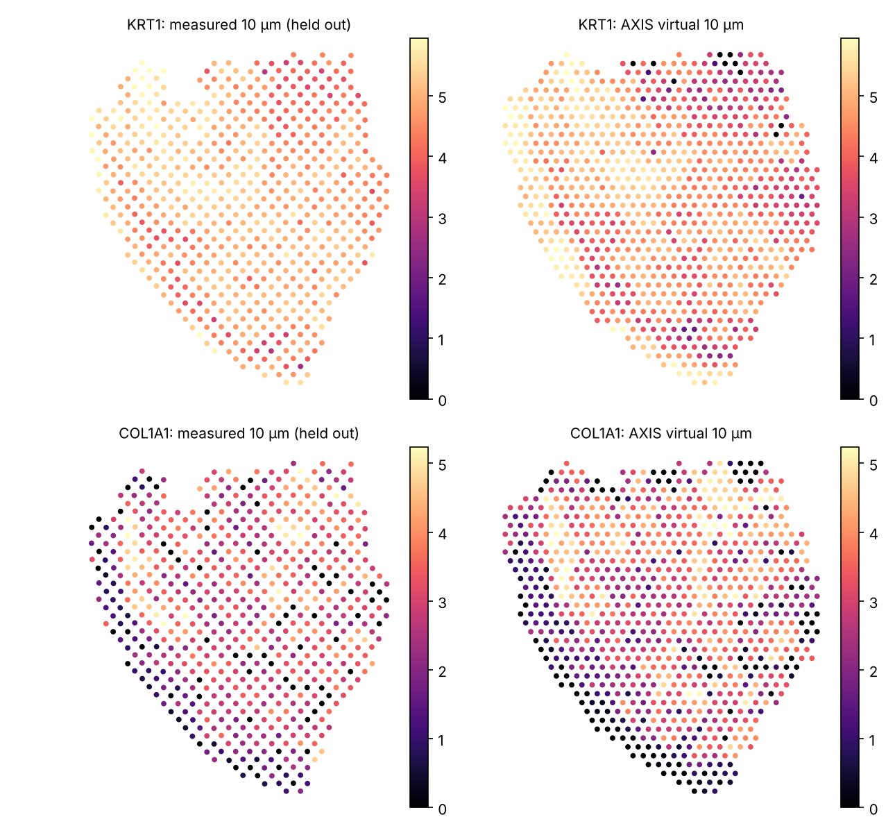

# Gallery: SCC patient 10

This page reproduces the SCC analysis of the manuscript (Fig. 3) on the
quickstart sample with the reorganised `axis` package and the manuscript's
trained SCC patient-10 model, without retraining. All numbers below come from
`examples/quickstart_scc.py` and from the manuscript's own pipeline and
evaluation scripts in `reproducibility/`.

!!! success "Summary"
    - **Alignment.** The transition fields reproduce the published alignment:
      the median distance between the transported spots and the published
      positions is **0 px**. 74% (10 µm) and 67% (20 µm) of the spots land on
      exactly the published pixel, and 95% / 90% lie within 1 px.
    - **Generation.** `axis.tl.generate` and the manuscript pipeline
      (`reproducibility/pipelines/generation/scc_depth.py`) produce a
      **bit-identical** virtual 10-µm section (expression, cluster
      probabilities and labels).
    - **Evaluation.** The generated section scores 0.198 / 0.271 / 0.158 on
      the Fig. 3c cluster metrics. The gene-pattern scores of Fig. 3f–g are
      0.576 / 0.395 / 0.363 for the marker genes and 0.520 / 0.291 / 0.269
      for the top-100 genes.

## Data

| Item | Details |
|---|---|
| Sample | Cutaneous squamous cell carcinoma, patient 10 (Ji *et al.*, *Cell* 2020; GEO GSE144240) |
| Sections | three serial 10x Visium sections at 0, 10 and 20 µm: 545, 619 and 460 spots |
| Morphology | H&E on a 512 × 512 px canvas; neighbouring spots are about 13.5 px apart |
| Clusters | `obs["original_clusters"]`: 8 clusters, the same labels in every section (7 occur in the 20-µm section) |
| Held out | the 10-µm section: it is not used for generation and serves as ground truth |

## Settings

**Pseudo-images** (`axis.pp.build_pseudoimages`, preset `"visium"`)

| Parameter | Value |
|---|---|
| normalisation | 10⁴ counts per spot, then log1p |
| features | genes shared by the three sections (14,197) |
| components | 10 principal components, each min–max scaled to [0, 1] |
| rasterisation | Gaussian kernel on a 32 × 32 grid of 16-px cells (σ = 8 px), 2 × 2 median filter, nearest-neighbour resize to 64 × 64 (1/8 of the canvas) |
| gene filter | the quickstart keeps all shared genes; the Fig. 3 pipeline run below first removed genes detected in fewer than 15 spots, as the original SCC preprocessing did (spots with fewer than 100 genes would also be removed; there are none). The resulting fields differ by 0.01 px on average |

**Transition-field network**

| Parameter | Value |
|---|---|
| network | `TransitionFieldNet`, transformer fusion, RGB H&E input, 512-px canvas |
| weights | manuscript model `scc_patient10_img_win9_gene_win5_frac0.95_gene0.5_generegu0/model_1000.pth` |
| training settings of these weights | morphology NCC window 9; molecular masked-NCC window 5 (≥ 95% overlap); λ_morph = 1, λ_mol = 0.5, λ_smooth = 1 (smoothness on the full-resolution field); Adam, learning rate 10⁻⁴, batch size 1; 1000 epochs |
| inference | evaluation mode on a 4-core CPU: fields for all 6 ordered section pairs within 59 s of starting (including data loading and pseudo-images); the whole quickstart takes 69 s |

**Spatial matching** (`axis.tl.match`, reference = section 0)

Spots of sections 1 and 2 are transported into section 0 with the
nearest-pixel inverse of their fields (`fields.transport`). *Neighbourhood
agreement* is the fraction of spots whose cluster is a majority cluster of the
section-0 spots within 1.5 spot distances (20.25 px).

**Generation** (`axis.tl.generate`, the settings of the Fig. 3 run)

| Parameter | Value |
|---|---|
| anchors → query | 0 µm and 20 µm → 10 µm; relative position α = 0.5, anchor weights β = (0.5, 0.5) |
| biological-axis bandwidth | σ_τ = 6.67 µm (one third of the anchor spacing) |
| output support | Visium-like hexagonal grid, `grid_size=40`: 1,650 locations, 13.75 px apart |
| tissue support | locations within `max_dist` = 10 px of the transported evidence (1,005 points), smoothed on the grid, largest connected region |
| spatial bandwidth | σ_x = 3 px, for both expression and clusters (no separate cluster bandwidth) |
| neighbours | k = 48 nearest evidence points (at least 1) |
| molecular-quality weight | γ_C = 1, γ_G = 0.7, relative coverage clipped to [0.5, 2] |
| genes | all 14,567 genes shared by the two anchors; raw counts, weighted mean |

**Evaluation** (the manuscript's scripts in `reproducibility/figure3/`)

| Metric | Definition |
|---|---|
| cluster composition | symmetric relative absolute error of the cluster fractions (generated vs held-out) |
| within-cluster spacing | Wasserstein distance between the nearest same-cluster distances, in units of each tissue's spot spacing |
| cluster connectivity | Jensen–Shannon distance (base 2) between the 6-nearest-neighbour cluster profiles |
| gene sets | 12 markers (KRT1, KRT5, KRT10, KRT14, KRT15, COL1A1, COL1A2, DCN, PECAM1, VWF, PTPRC, CD3D) and the 100 most highly expressed other genes of the held-out section |
| gene preprocessing | 10⁴ counts per spot and log1p; smoothing over 12 neighbours, z-score, local gradients (8 neighbours) and gradient trend (28 neighbours), rasterised on a 64 × 64 grid |
| gradient-map similarity | NCC of the gradient-strength maps, maximised over rotations of ±12° (3° steps) and shifts of ±6 cells (2-cell steps) |
| orientation similarity | Pearson correlation of the axial gradient orientations (cos 2θ, sin 2θ) in cells above the 60th percentile of the held-out gradient strength |
| weighted orientation similarity | the same over all cells, with orientations weighted by normalised gradient strength |

Cluster metrics are averaged over clusters and gene metrics over the genes of
each set. Lower is better for the cluster metrics, higher for the gene metrics.

## Results

### Alignment

| Spatial matching to section 0 | before | this package, manuscript model | published |
|---|---|---|---|
| 10 µm, neighbourhood agreement | 0.624 | 0.706 | 0.715 |
| 20 µm, neighbourhood agreement | 0.551 | 0.707 | 0.714 |
| 10 µm, median displacement | — | 19.2 px | 19.1 px |
| 20 µm, median displacement | — | 29.1 px | 29.2 px |

| Agreement with the published positions | 10 µm | 20 µm |
|---|---|---|
| median distance | 0 px | 0 px |
| spots on exactly the published pixel | 74% | 67% |
| spots within 1 px | 95% | 90% |

The published positions are whole pixels chosen by a nearest-pixel inverse
of the field. For the remaining spots, the published pixel is almost as good a
solution under the recomputed field: it maps back to within 0.16 px (10 µm)
and 0.23 px (20 µm), median, of the best pixel. Sub-pixel differences between
the original GPU computation and this CPU run therefore move these spots to a
neighbouring pixel, which also explains the small differences in
neighbourhood agreement.


*Fixed (0 µm) and moving (20 µm) H&E, the moving section warped by the
learned field, and green/magenta overlays before and after.*


*All three sections before and after transport into the frame of section 0
(colour: cluster, marker: section).*

### Virtual tissue at 10 µm


*The 10-µm section generated from the 0- and 20-µm anchors (849 supported
locations), next to the measured sections.*



*KRT1 (epithelium) and COL1A1 (stroma) in the held-out 10-µm section and in
the generated section; 10⁴ counts per spot, log1p, one colour scale per gene
(0 to the 99th percentile of both).*

| Fig. 3c, cluster fidelity (lower is better) | AXIS |
|---|---|
| cluster composition | 0.198 |
| within-cluster spacing | 0.271 |
| cluster connectivity | 0.158 |

| Fig. 3f–g, gene-pattern fidelity (higher is better) | 12 marker genes | top-100 genes |
|---|---|---|
| gradient-map similarity | 0.576 | 0.520 |
| orientation similarity | 0.395 | 0.291 |
| weighted orientation similarity | 0.363 | 0.269 |

Both tables come from the manuscript's evaluation scripts
(`reproducibility/figure3/3bc_cluster_evaluation.py` and
`3defg_gene_evaluation.py`), run on the output of the Fig. 3 pipeline. The
quickstart's own virtual section gives the same cluster metrics. Its
`axis.metrics` implementation matches the script to machine precision. Its
gene metrics agree within 0.001. The SpatialZ comparison of Fig. 3 is not
repeated here.

## Training from scratch on a CPU

Without a trained model, the quickstart can train the network itself. On a
4-core CPU without a GPU, training at 512 px does not fit in memory, so this
run used half the resolution and a short schedule:

```bash
python examples/quickstart_scc.py --data-dir scc_patient10 \
    --canvas-size 256 --max-steps 400
```

That is 400 optimisation steps (about 67 epochs over the 6 pairs) on a
256-px canvas, taking 55 min. The pixel-unit generation settings are halved
(σ_x = 1.5 px, `max_dist` = 5 px).

| | CPU run (256 px, 400 steps) | manuscript model (512 px, 1000 epochs) |
|---|---|---|
| 10 µm, neighbourhood agreement | 0.676 | 0.706 |
| 20 µm, neighbourhood agreement | 0.662 | 0.707 |
| distance to the published positions (median) | 3.5 px / 4.6 px on the 256-px canvas (spots 6.75 px apart) | 0 px |
| supported locations of the virtual section | 882 | 849 |
| cluster composition | 0.166 | 0.198 |
| within-cluster spacing | 0.307 | 0.271 |
| cluster connectivity | 0.168 | 0.158 |

The short CPU run recovers most of the alignment but not the manuscript's
accuracy. Full training (512 px, 1000 epochs) needs a GPU: on this CPU, a
single 512-px training step exceeds 13 GB of memory.

## Reproducing this page

```bash
# results with a trained model (inference only, about 70 s on 4 CPU cores)
python examples/quickstart_scc.py --data-dir scc_patient10 --out quickstart_out \
    --checkpoint scc_patient10_model_1000.pth --epochs 0
```

`quickstart_out/report.json` contains the alignment and Fig. 3c numbers
above, and the figures are written next to it.

To run the Fig. 3 pipeline itself, put the following below the SCC data root
(`$AXIS_DATA_DIR/SCC/huifang`):

- `h5ad/10_{0,1,2}.h5ad`: the sample files;
- `network_input/10_{k}_validation.npz`: canvas coordinates under the key `coord`;
- `pairwise_output/group_10/{fixed}_{moving}_flow.npy`: the fields, written by `fields.save(...)`.

Then run `reproducibility/pipelines/generation/scc_depth.py` and the
evaluation scripts in `reproducibility/figure3/` (see
[Reproducibility](reproducibility.md)).
