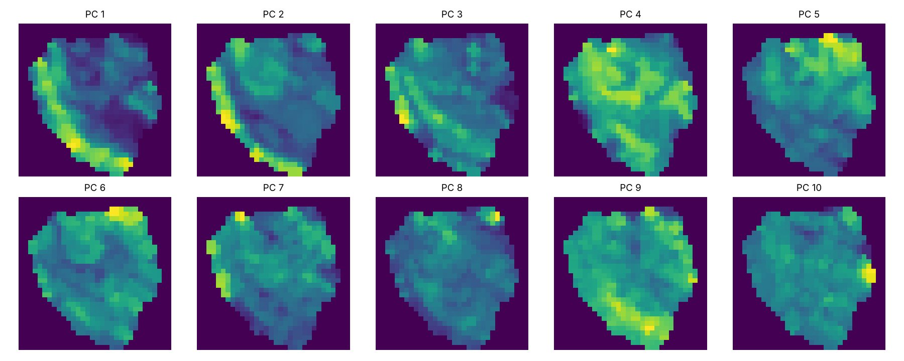
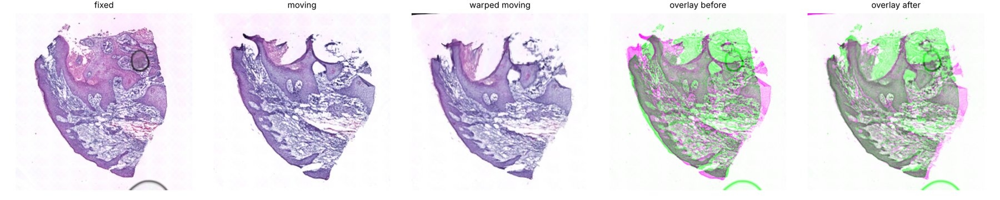
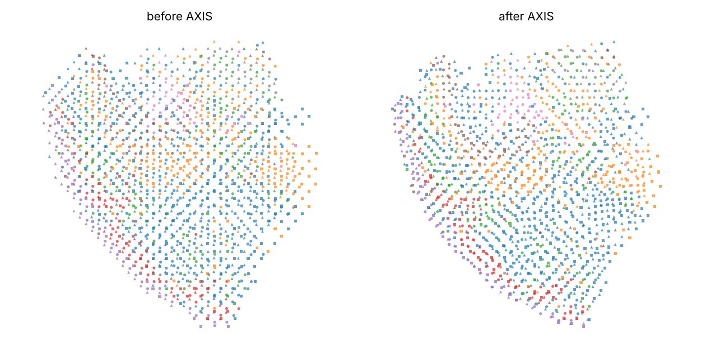
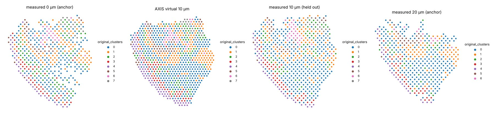
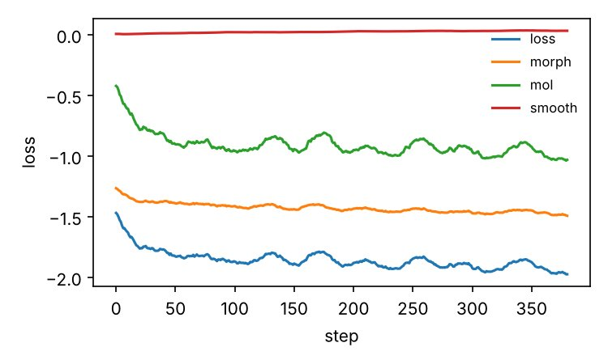

# Gallery

Outputs of the quickstart (`examples/quickstart_scc.py`) on SCC patient 10,
run on a 4-core CPU without a GPU:

```bash
python examples/quickstart_scc.py --data-dir scc_patient10 --canvas-size 256 --max-steps 400
```

The network was trained from scratch for 400 steps on a 256-px canvas
(55 min); the paper's models use 512-px canvases and 1000 epochs. Rerunning
from the saved model with `--checkpoint quickstart_out/model/model_final.pth --epochs 0`
reproduces the same numbers in 81 s.

## Molecular pseudo-image

The first 10 principal components of section 0, rasterised at 1/8 of the
canvas resolution (Methods, Eq. 1).



## Transition field: 20 µm → 0 µm

Fixed and moving H&E, the moving section warped by the learned field, and
green/magenta overlays before and after.



## Spatially matched sections

All three sections before and after transport into the frame of section 0
(colour: cluster, marker: section).



## Virtual tissue at 10 µm

The 10-µm section generated from the 0- and 20-µm anchors (α = 0.5) on a
Visium-like grid, next to the measured 10-µm section that was held out.



## Training curve



## Numbers (`report.json`)

Neighbourhood agreement is the fraction of spots whose cluster matches the
majority cluster of section-0 spots within 1.5 spot distances. "Published"
is the AXIS alignment stored with the sample (`obsm["spatial_axis"]`).

| | before | this run | published |
|---|---|---|---|
| 10 µm → 0 µm, neighbourhood agreement | 0.624 | 0.676 | 0.715 |
| 20 µm → 0 µm, neighbourhood agreement | 0.551 | 0.662 | 0.714 |

Median distance between this run's and the published transported spots:
3.5 px (10 µm) and 4.6 px (20 µm) on the 256-px canvas, where neighbouring
spots are 6.75 px apart (about 0.5 and 0.7 spot spacings).

The generated section has 882 supported spots. Its cluster composition
differs from the held-out section by a mean symmetric relative error of
0.164, against 0.142 when section 0 is simply copied, so this short CPU run
does not beat that baseline on composition. Use the paper's settings
(512 px, full training) to evaluate generation quality.
