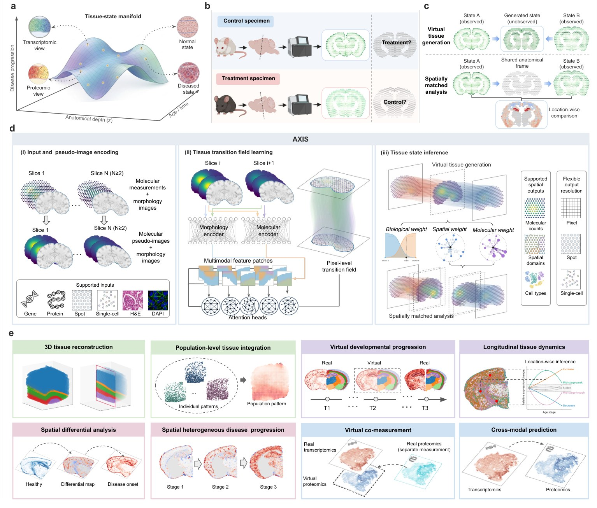

# AXIS

**Virtual tissue generation and spatially matched analysis from spatial omics.**

AXIS learns dense, bidirectional *transition fields* between spatial-omics
tissue sections by integrating molecular measurements — encoded as
pseudo-images — with H&E or DAPI morphology. The fields support two
complementary operations:

<div class="grid cards" markdown>

-   **Virtual tissue generation**

    Infer unmeasured tissue states (intermediate depths, ages, disease states)
    in their expected anatomy, on pixel grids, Visium-like spots or single cells.

-   **Spatially matched analysis**

    Place independently measured tissues in one anatomical frame for
    location-wise comparison, population-level integration and cross-modality
    co-measurement.

</div>



*Manuscript Fig. 1 — (d) AXIS converts molecular profiles into pseudo-images,
learns pixel-level transition fields with a multimodal coarse-to-fine network
and infers tissue states with biological, spatial and molecular weights;
(e) applications.*

## At a glance

```python
import axis

adatas = axis.datasets.load_scc_sample("scc_patient10")
for a in adatas:
    axis.pp.prepare_canvas(a, spatial_key="spatial_image_coor", canvas_size=512)
axis.pp.build_pseudoimages(adatas, n_comps=10)

fields = axis.tl.fit_transition(adatas, max_steps=3000)
axis.tl.match(adatas, fields, reference=0)
virtual = axis.tl.generate(adatas, fields, positions=[0, 10, 20], query=10, anchors=[0, 2])
```

- [Installation](installation.md) · [Quickstart](quickstart.md) · [Tutorials](tutorials/index.md)
- [API reference](api/index.md) · [Method summary](method.md)
- [Reproducing the manuscript](reproducibility.md)
